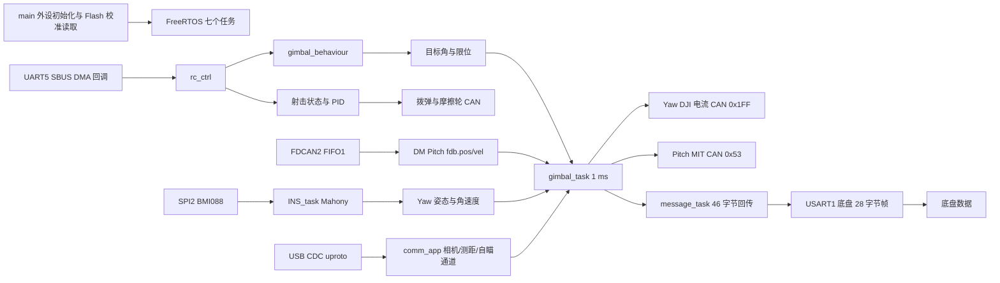

# H723 云台工程运行链与安全清理（2026-11-06）

## 判定边界

本次以 `MDK-ARM/CtrlBoard-H7_IMU.uvprojx` 唯一有效 Target 为入口：STM32H723VGTx、ARMCC 5.06、110 个原始 Keil 条目；`User/APP/robot_param.h` 的有效配置为 `Infantry_robot / Steering_wheel / yaw_pitch_direct / friction_3508 / gimbal_board`，`ROBOT_MODE=debug`。本目录有 Git；开始时 `User/gimbal/yaw_pitch_direct.c` 已有未提交修改，移除了 `pitch_dm_cali_load()` 调用。本批保留这处已有修改。

删减证据由 Target、实际任务创建、IRQ/DMA/回调、函数调用/函数指针、MAP 移除项和编译共同组成。冻结控制参数与周期、CAN/USART 帧、错误输出、初始化顺序、Flash 校准布局。没有运行 CubeMX 或烧录设备。

## 当前数据链路

| 路径 | 实际入口与消费者 |
| --- | --- |
| 启动与任务 | `Core/Src/main.c` 初始化 GPIO/DMA/SPI2/FDCAN1-3/USART1/UART5/USART10/UART7/ADC/OCTOSPI 等，先调用 `cali_param_init()`；`Core/Src/freertos.c` 创建 default、gimbal、cali、auto_aim、COMM_APP、message、INS 七任务。未创建 detect_task。 |
| 遥控到 Pitch | UART5 `HAL_UARTEx_RxEventCallback` → `sbus_to_rc` 的 `rc.ch[3]` 和 `s[0]` → `gimbal_behaviour_mode_set` → `gimbal_relative_angle_control` → `gimbal_relative_angle_limit` → `relative_angle_set` → `emit_pos_set` → MIT 目标步进 → `CAN_cmd_MIT`；右侧三档开关中档行为 6、下档行为 4。 |
| Pitch 反馈 | FDCAN2 FIFO1 的 `0x53` → `DMFdbData` → `DM_MOTOR_MEASURE[2].fdb` → `gimbal_feedback_update` 与 MIT 发送门控。当前 `PITCH_DM_ZERO_OFFSET_RAD=0`，软件限位默认 `[-2.5,-2.0] rad`。 |
| Yaw 与射击 | DJI 反馈以 ID 分发至 `DJI_MOTOR_MEASURE`；IMU 经 BMI088/Mahony 进入 Yaw 姿态反馈；`gimbal_control_loop` 形成 Yaw 电流并用 `CAN_cmd_gimbal` 发 `0x1FF`。`shoot_control_loop` 处理拨弹电流，`CAN_cmd_friction` 发摩擦轮电流。 |
| 板间通信 | USART1 DMA 接收后调用 `chassis_to_gimbal` 解析 28 字节；`message_task` 发固定 46 字节，含 Yaw、INS、行为、射击和 VTM 默认载荷/清零预留。 |
| USB/测距/相机 | defaultTask 初始化 USB；CDC 接收进入 `uproto_on_rx_bytes`，`COMM_APP` 绑定通道并发布数据；主机自瞄增量进入 `auto_aim_apply_delta_udeg`。USART10 回调给 TFmini，CAM_TRIG EXTI 进入相机触发。`COMM_APP` 还调用一次 USB 初始化，需单独核对。 |
| 校准/故障 | `cali_param_init` 读旧 HD/GM Flash；`calibrate_task` 处理显式 DM Pitch 采样/写入。当前已有未提交修改让 `pitch_dm_cali_load` 没有调用者，因此新 Pitch 限位不能掉电恢复。`toe_is_error` 有控制消费者，但 detect_task 未创建，当前在线/掉线更新链不完整。 |

## 已执行的五批删减

| 批次 | 实际删减 | Keil 结果 | 固件变化 |
| --- | --- | --- | --- |
| 基线 | 1395 个源码/配置快照文件；110 Keil 条目；133 本地 C/H | 0 错误 / 40 警告 | Code 112040，RO 2144，RW 1152，ZI 58704 |
| 01 | 未调用的 uproto 占位函数、备用时间源、旧 USB 写函数及自瞄无读者变量 | 0 / 34 | Code -28，RW -16 |
| 02 | 由旧 USB 写函数遗留的环缓冲、两个私有函数和宏 | 0 / 33 | RW -4，ZI -2052 |
| 03 | 非活动的 DM POS/SPEED/EMIT 发送协议与声明 | 0 / 33 | 可执行体大小不变；原函数本已被链接器剔除 |
| 04 | `bsp_usb.c/.h` 演示模块、Keil 条目和两个无用 include | 0 / 33 | 可执行体大小不变；Keil 条目 110→109 |
| 05 | 不再被调用的旧云台编码器端点计算与声明；保留历史校准存储布局 | 0 / 33 | 可执行体大小不变；原函数本已被链接器剔除 |

最终为 1393 个源码/配置快照文件、109 个 Keil 条目、131 个本地 C/H。应用层 C/H 源码行数 17326→16844。五批源码恢复包依次位于 `AI_Workspace/snapshots/after-full-runtime-cleanup-01-2026-11-06/` 至 `...-05-2026-11-06/`；基线为 `before-full-runtime-cleanup-2026-11-06/`。每阶段有源码 ZIP、SHA-256 清单、完整构建日志、MAP、警告清单和审计；最终阶段另存 AXF/HEX/MAP。逐批差异见 `AI_Workspace/artifacts/validation/full-cleanup-0N-stage-comparison.json`。

## 验证与保留项

最终 Keil：0 errors / 33 warnings，Code 112012、RO 2144、RW 1132、ZI 56652；最终 AXF SHA-256 `68C5BCA707D5E4FB1862A9E607BB1C5795690ED52EB551EE02912E563BB476AA`。本地项目路径核对通过（0 外部路径、0 缺失）。最终 ARMCC/Unicorn 离线检查：板间帧 26、MIT 17、Pitch 目标链 10 项均通过。函数体对照中 482 个可比较函数的 480 个一致；差异仅为本批删掉的 `auto_aim_set` 无读者变量和 `auto_aim_apply_delta_udeg` 无读者赋值，该通用工具因两处预期差异返回非零，差异文件保存在 `artifacts/validation/full-cleanup-02-invariants/`，未把它报告为全通过。

`candidates.csv` 逐项列出已删、待确认与功能缺口。特别保留：UART7 初始化/DMA/IRQ（现车用途未知），SHOOT_DETECT EXTI（物理用途未知），detect_task 与 `toe_is_error`（故障语义未理清），旧 HD/GM 校准布局，以及两份字节相同的 CRC C/H（主机 CMake 仍编译 `User/Communication/core` 副本；本机无主机 C++ 工具链，未做替换验证）。`User/Communication/example/device` 是活跃 USB、相机、TFmini 与时间同步业务。CubeMX 生成继续留在隔离区，正式工程未重生成。

Keil、MAP 和合成帧只证明离线边界；云台实体运动、设备掉电校准、实际故障保护、UART7 与 EXTI 接线仍需设备验证。
